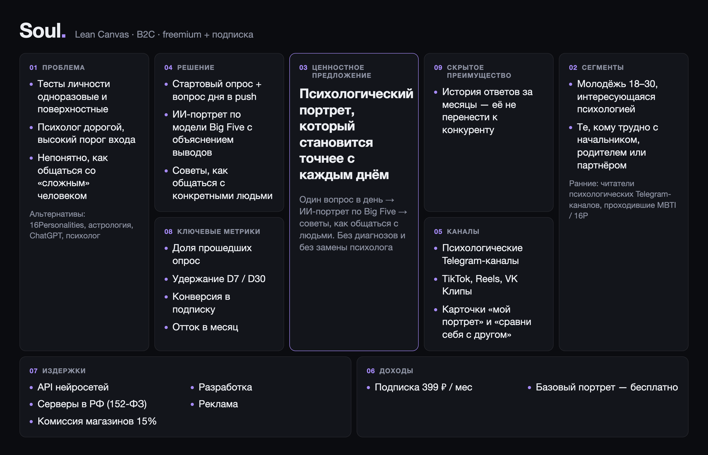
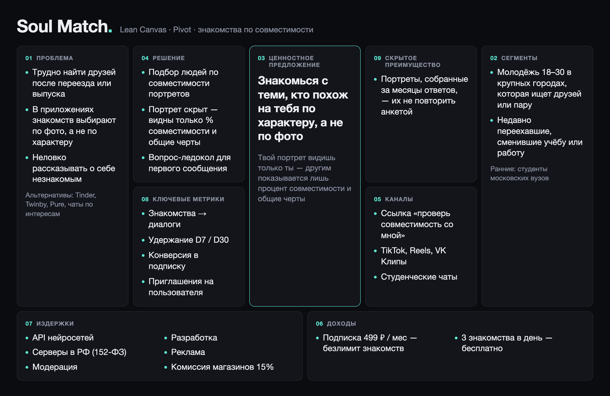

# Soul — психологический портрет по вопросу в день

## Задание 1

**Бизнес-модель:** B2C, freemium + подписка. Базовый портрет бесплатный, полный — 399 ₽ в месяц.

**Идея:** мобильное приложение для iOS и Android. После регистрации пользователь проходит короткий опрос, а потом раз в день получает push с интересным вопросом. ИИ анализирует ответы и постепенно собирает психологический портрет по модели Big Five. Портрет помогает понять себя и подсказывает, как общаться с конкретными людьми. Soul не ставит диагнозов и не заменяет психолога.

### Elevator Pitch

Тесты личности проходят миллионы людей и забывают результат через неделю, а к психологу идти дорого и страшно. Soul каждый день задаёт тебе один интересный вопрос и с помощью ИИ собирает твой психологический портрет. Чем дольше пользуешься, тем он точнее: показывает сильные стороны, объясняет повторяющиеся реакции и подсказывает, как найти общий язык с трудным начальником или родителем. Базовый портрет бесплатный, полный — 399 ₽ в месяц. Начинаем с молодёжи 18–30 лет из психологических Telegram-каналов.

### Lean Canvas

## Задание 2

### Риски

- **Ценность.** Пользователи могут забросить вопросы через неделю или не захотеть платить.
- **Жизнеспособность.** Реклама в B2C дорогая, а подписки на приложения часто отменяют.
- **Осуществимость.** Портрет по текстовым ответам может получиться неточным.
- **Юзабельность.** Отвечать на вопрос каждый день может надоесть, а портрет может оказаться сложным для понимания.

### Ключевые гипотезы

| | Гипотеза | Какой риск | Если не подтвердится |
|---|---|---|---|
| **H1** | Люди 18–30 лет готовы каждый день отвечать на вопрос и платить за полный портрет: за 14 дней минимум 40% ответят на 10 вопросов, минимум 5% заплатят 399 ₽ | **Ценность:** портрет нужен настолько, что ради него отвечают и платят | Портрету не из чего строиться, а продукту не на чем зарабатывать |
| **H2** | По 20–30 текстовым ответам ИИ составляет портрет, который совпадает с проверенным тестом Big Five (корреляция от 0,6), и люди оценивают его точность на 4 из 5 и выше | **Осуществимость:** по тексту вообще можно точно определить характер | Портрету не верят, нужны другие данные — голос, переписка |

**Главная — H1.** Если люди не отвечают и не платят, неважно, насколько точен портрет.

### HADI для H1

Проверяем без разработки: приложения и бота нет, вместо них работаем вручную через обычный Telegram.

**H:** если людям 18–30 лет 14 дней присылать по вопросу в день и потом показать предварительный портрет, то минимум 40% ответят на 10 вопросов из 14, а минимум 5% купят полный портрет за 399 ₽.

**A:** создаём закрытый Telegram-канал и каждый вечер публикуем в нём вопрос дня, ответы люди пишут в личные сообщения. Вопросы составляем вместе со знакомым психологом. На 14-й день вручную собираем ответы каждого, через ChatGPT делаем короткий портрет и отправляем его. Полный портрет предлагаем за 399 ₽ по ссылке на оплату. Участников набираем посевами в 3–5 психологических Telegram-каналах, цель — 300 человек. Тест идёт 3 недели, бюджет около 15 000 ₽.

**D:** сколько человек прошли стартовый опрос, сколько ответили на 10 и больше вопросов, как оценили точность портрета (1–5), сколько заплатили. В конце 10 коротких интервью.

**I:**
- удержание от 40% и оплата от 5% — гипотеза подтвердилась, делаем приложение;
- удержание от 40%, но оплата ниже 5% — ценность есть, люди не готовы платить: пробуем цену 199 ₽ и проверяем Pivot;
- удержание ниже 40% — вопросы неинтересны, переделываем их и повторяем тест.

### Юнит-экономика

Юнит — один платящий подписчик.

**Откуда пользователи:** таргетированная реклама в VK и посевы в психологических Telegram-каналах, позже — карточки «мой портрет», которыми делятся в соцсетях.

**На чём зарабатываем:** базовый портрет бесплатный, полный портрет, советы по общению и чат с ИИ — по подписке 399 ₽ в месяц.

**CAC:** клик в рекламе VK и Telegram — 15 ₽, приложение ставят 30%, стартовый опрос проходят 60%, подписку оформляют 5%.

CAC = 15 / 0,3 / 0,6 / 0,05 ≈ **1 670 ₽**

**LTV:**
- подписка 399 ₽ в месяц, после комиссии магазина 15% остаётся 339 ₽;
- ИИ и серверы — 70 ₽ в месяц;
- бесплатные пользователи тоже стоят денег: на одного платящего приходится 19 бесплатных по 2 ₽ — 38 ₽ в месяц;
- остаётся 231 ₽ в месяц;
- в месяц отписываются 15%, значит пользователь платит в среднем 1 / 0,15 ≈ 6,7 месяца.

LTV = 231 × 6,7 ≈ **1 540 ₽**

**LTV / CAC ≈ 0,9.** Это меньше 1: каждый подписчик приносит убыток, экономика не сходится.

### Pivot

Меняем ценность: не «узнай себя», а «найди своих». **Soul Match** подбирает друзей и пару по совместимости психологических портретов. По умолчанию портрет скрыт: другие видят только процент совместимости и 2–3 общие черты, а подробности — только если ты сам решишь их открыть.

Почему это должно сработать:
- за знакомства люди платят охотнее, чем за самоанализ;
- ссылка «проверь нашу совместимость» сама приводит друзей, поэтому привлечение дешевле;
- портреты, собранные в MVP, становятся основой подбора — их не повторить анкетой за 5 минут;
- похожие модели уже работают: в Китае Soul App знакомит людей по тесту личности, в России Twinby — по психологической совместимости.

Новый риск — нужно много людей в одном городе, иначе подбирать некого. Поэтому запускаемся только в Москве и начинаем с поиска друзей.

**Pitch:** в приложениях знакомств выбирают по фото, а найти друзей после переезда или выпуска почти негде. Soul Match каждый день задаёт тебе интересный вопрос, собирает твой психологический портрет и знакомит с людьми, похожими на тебя по характеру. Сам портрет видишь только ты, другим показывается лишь совместимость. 3 знакомства в день бесплатно, безлимит — 499 ₽ в месяц.

**CAC:** клик 15 ₽, приложение ставят 30%, опрос проходят 60% — один активный пользователь из рекламы стоит 83 ₽. Каждый второй по ссылке «проверь совместимость» бесплатно приводит ещё одного человека, поэтому в среднем активный пользователь стоит 83 / 1,5 ≈ 56 ₽. Подписку оформляют 8%.

CAC = 56 / 0,08 ≈ **700 ₽**

**LTV:**
- подписка 499 ₽ в месяц, после комиссии магазина 15% остаётся 424 ₽;
- ИИ и серверы — 70 ₽ в месяц;
- на одного платящего приходится 11,5 бесплатных по 2 ₽ — 23 ₽ в месяц;
- остаётся 331 ₽ в месяц;
- в месяц отписываются 20% (нашли друзей — ушли), значит пользователь платит в среднем 5 месяцев.

LTV = 331 × 5 ≈ **1 650 ₽**

**LTV / CAC ≈ 2,4.** Экономика сходится, привлечение окупается примерно за 2 месяца. Даже если приглашения не сработают, CAC = 83 / 0,08 ≈ 1 040 ₽ и LTV / CAC ≈ 1,6 — всё ещё больше 1.

## Задание 3

### Роли

- **Пользователь** — отвечает на вопросы и смотрит свой портрет.
- **Ищущий знакомств** — находит людей с похожим портретом через Soul Match (роль из Pivot).
- **Администратор** — это мы: ведём банк вопросов, разбираем жалобы и следим за безопасностью.

### User Stories и RICE

RICE = Reach × Impact × Confidence / Effort.
- **Reach:** сколько тысяч пользователей затронет за квартал (план — 10 тысяч).
- **Impact:** 0,5 — слабо, 1 — средне, 2 — сильно, 3 — очень сильно.
- **Confidence:** уверенность в оценке, от 0,5 до 1.
- **Effort:** человеко-недели.

| ID | История | R | I | C | E | RICE | Куда |
|---|---|---|---|---|---|---|---|
| US-01 | Как пользователь, я хочу пройти короткий стартовый опрос, чтобы сразу получить первые выводы о себе. | 10 | 3 | 1 | 2 | 15 | MVP |
| US-02 | Как пользователь, я хочу войти через Apple, Google или Telegram, чтобы не заполнять длинные формы. | 10 | 2 | 1 | 1,5 | 13,3 | MVP |
| US-03 | Как пользователь, я хочу удалить все свои данные одной кнопкой, чтобы быть уверенным в приватности. | 10 | 1 | 1 | 1 | 10 | MVP |
| US-04 | Как пользователь, я хочу оформить и отменить подписку, чтобы открыть полный портрет. | 8 | 2 | 1 | 2 | 8 | MVP |
| US-05 | Как пользователь, я хочу получать один вопрос в день в удобное время, чтобы портрет уточнялся без лишних усилий. | 8 | 3 | 0,8 | 3 | 6,4 | MVP |
| US-06 | Как пользователь, я хочу видеть свой психологический портрет простым языком, чтобы лучше понимать свои реакции. | 8 | 3 | 0,8 | 4 | 4,8 | MVP |
| US-07 | Как пользователь в тяжёлом состоянии, я хочу увидеть контакты экстренной помощи, чтобы получить реальную поддержку. | 10 | 1 | 0,8 | 2 | 4 | MVP |
| US-08 | Как администратор, я хочу менять банк вопросов без обновления приложения, чтобы быстро улучшать контент. | 10 | 0,5 | 1 | 1,5 | 3,3 | MVP |
| US-09 | Как пользователь, я хочу поделиться карточкой со своим портретом в соцсетях, чтобы рассказать о себе друзьям. | 4 | 1 | 0,8 | 1 | 3,2 | MLP |
| US-10 | Как пользователь, я хочу видеть, как меняется мой портрет, чтобы был стимул отвечать дальше. | 6 | 1 | 0,8 | 2 | 2,4 | MLP |
| US-11 | Как пользователь, я хочу поговорить с ИИ, который знает мой портрет, чтобы получить личный совет. | 5 | 2 | 0,8 | 4 | 2 | MLP |
| US-12 | Как пользователь, я хочу описать сложного для меня человека и узнать, как с ним общаться, чтобы было меньше конфликтов. | 3 | 2 | 0,5 | 3 | 1 | MLP |
| US-13 | Как пользователь, я хочу сравнить свой портрет с портретом друга, чтобы лучше понять наши отношения. | 3 | 2 | 0,5 | 4 | 0,75 | MLP |
| US-14 | Как пользователь, я хочу отвечать голосом, чтобы не печатать. | 3 | 1 | 0,5 | 5 | 0,3 | Позже |
| US-15 | Как ищущий знакомств, я хочу находить людей с похожим портретом, чтобы заводить новых друзей. | 2 | 3 | 0,5 | 10 | 0,3 | Позже (Pivot) |
| US-16 | Как ищущий знакомств, я хочу скрыть свой портрет и показывать только процент совместимости, чтобы знакомые не узнали лишнего. | 2 | 1 | 0,5 | 4 | 0,25 | Позже (Pivot) |

### MVP и MLP

**MVP: US-01 – US-08.** Это минимум, без которого сервис не работает: вход, опрос, вопрос дня, портрет и оплата. Сюда же входят удаление данных и экран экстренной помощи. Их балл невысокий, но без них продукт нельзя запускать по закону и этике.

**MLP = MVP + US-09 – US-13.** Это то, за что приложение полюбят: динамика портрета, чат с ИИ, советы по общению, совместимость с другом и карточки для соцсетей. Последние две фичи ещё и бесплатно приводят новых пользователей.

**Позже:** голос — дорого. Поиск людей и скрытый портрет — это Pivot: делаем их после MVP, когда наберётся база пользователей с готовыми портретами.

### Требования к двум главным историям

#### US-05. Вопрос дня

Функциональные:

- FR-05.1. Я могу выбрать время вопроса с 8:00 до 23:00 с шагом 30 минут. По умолчанию — 20:00 по времени телефона.
- FR-05.2. Я получаю ровно один push с вопросом в день в выбранное время (±5 минут).
- FR-05.3. Я могу ответить текстом (10–1000 символов), по шкале 1–5 или выбрать вариант, в зависимости от вопроса.
- FR-05.4. Я могу пропустить вопрос или попросить другой, не больше 2 раз в день. Один и тот же вопрос не повторяется 90 дней.
- FR-05.5. После ответа я вижу короткий вывод (1–3 предложения) и насколько заполнен мой портрет.
- FR-05.6. Если в ответе есть признаки кризиса, вместо вывода я вижу контакты экстренной психологической помощи.
- FR-05.7. Если я не отвечаю 3 дня подряд, вопросы приходят раз в 2 дня. После ответа снова приходят каждый день.

Нефункциональные:

- NFR-05.1. Вопрос открывается из push за 2 секунды или быстрее (4G), вывод после ответа появляется за 5 секунд в 95% случаев.
- NFR-05.2. Сервер выдерживает 50 000 push в течение одной минуты, потому что многие выбирают одно и то же время.
- NFR-05.3. В тексте push нет личных данных и прошлых ответов.
- NFR-05.4. Один вопрос с выводом стоит не больше 0,05 ₽ на API нейросети, иначе не сойдётся юнит-экономика.

#### US-06. Психологический портрет

Функциональные:

- FR-06.1. Я вижу первый портрет сразу после стартового опроса (20 вопросов).
- FR-06.2. Я вижу оценки 5 черт Big Five от 0 до 100 и описание каждой черты в 2–4 предложениях простым языком.
- FR-06.3. У каждого вывода есть кнопка «Почему так?», которая показывает 1–3 моих ответа, на которых он основан.
- FR-06.4. Я могу отметить вывод как «неточно», и это учтётся при следующем пересчёте.
- FR-06.5. Бесплатно я вижу оценки черт и короткие описания, а с подпиской — сильные стороны, зоны роста и советы по общению.
- FR-06.6. На экране портрета всегда есть надпись «Не является медицинской или психологической диагностикой». Диагнозов в тексте нет.

Нефункциональные:

- NFR-06.1. Экран портрета открывается за 1,5 секунды или быстрее, пересчёт после ответа занимает не больше минуты.
- NFR-06.2. На тестовой выборке из 100 человек оценки черт совпадают с проверенным опросником Big Five (корреляция от 0,6).
- NFR-06.3. Портрет видит только его владелец. Данные передаются по HTTPS и хранятся в зашифрованном виде на серверах в России (152-ФЗ). В нейросеть ответы уходят без имени и контактов.
- NFR-06.4. После удаления аккаунта портрет и ответы стираются за 24 часа, из резервных копий — за 30 дней.
