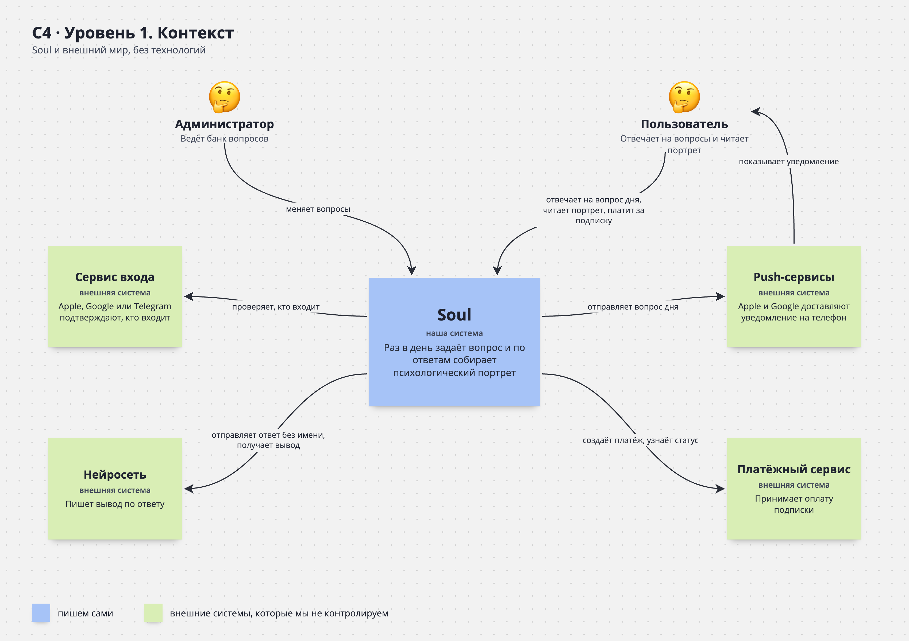
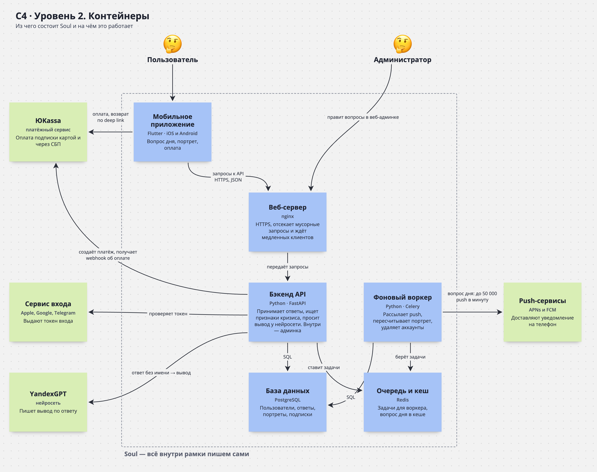

# Soul — архитектура (задание 5)

Soul — приложение, которое раз в день задаёт вопрос и по ответам собирает психологический портрет. Бизнес-модель и User Stories лежат в ветке `hw-1-2-3`, DDD, BDD и API — в ветке `hw-4`.

## C4, уровень 1: контекст

Внешних систем четыре: вход, push, нейросеть и оплата. Нейросеть получает ответ без имени и контактов.

## C4, уровень 2: контейнеры

Ответ на вопрос дня проходит так: приложение → nginx → бэкенд. Бэкенд проверяет ответ на признаки кризиса, получает вывод у нейросети, сохраняет его в PostgreSQL и ставит в Redis задачу пересчитать портрет. Воркер забирает эту задачу. Он же каждую минуту находит пользователей, у которых наступило время вопроса, и рассылает им push.

## Стек MVP

| Часть | Выбор | Почему |
|---|---|---|
| Мобильное приложение | Flutter | Один код на iOS и Android вместо двух отдельных приложений |
| Бэкенд | Python, FastAPI | Python быстро писать, и под него есть готовые клиенты нейросетей |
| Админка | SQLAdmin внутри бэкенда | Формы для банка вопросов (US-08) строятся по тем же моделям, отдельное приложение не нужно |
| Веб-сервер | nginx | HTTPS, отсекает мусорные запросы, ждёт медленных клиентов вместо бэкенда, ограничивает частоту запросов |
| База данных | PostgreSQL | Пользователи, ответы, портреты и подписки связаны между собой. Оплату нужно записывать в транзакции. Черты портрета хранятся в JSONB |
| Очередь | Redis + Celery | Рассылка, пересчёт портрета и удаление аккаунта (US-03) идут в фоне. Redis заодно кеширует вопрос дня |
| Нейросеть | YandexGPT | Ответы не уходят за границу (152-ФЗ, NFR-06.3), оплата в рублях |
| Платежи | ЮKassa | Карты и СБП, есть webhook об оплате |
| Хостинг | Yandex Cloud | Серверы в России и управляемый PostgreSQL: бэкапы и обновления базы делает облако |

**FastAPI вместо Django и Go.** Вывод появляется за 5 секунд (NFR-05.1), и почти всё это время бэкенд ждёт нейросеть. Синхронный воркер Gunicorn в это время больше ничего не делает. На сервере с 4 ядрами 8 воркеров (ядра × 2), значит, 8 / 5 с ≈ 1,6 ответа в секунду. Асинхронный FastAPI, пока ждёт нейросеть, обслуживает другие запросы. Go выдержал бы больше, но писать на нём дольше.

**Очередь.** Многие выбирают одно и то же время вопроса, поэтому нужно разослать 50 000 push за минуту (NFR-05.2). Если рассылать из бэкенда, в эту минуту он перестанет отвечать пользователям. Kafka и RabbitMQ для такого объёма избыточны: Redis уже стоит для кеша, Celery работает поверх него.

S3 в MVP не нужен: файлов нет. Он понадобится, когда появятся ответы голосом (US-14) и карточки портрета (US-09).

**Оплата.** Приложение просит бэкенд создать платёж, и бэкенд получает у ЮKassa ссылку на оплату. Пользователь платит, ЮKassa возвращает его в приложение по deep link, а приложение один раз спрашивает у бэкенда статус. Подписку включает только webhook от ЮKassa: если приложение пишет «я оплатил», сервер ему не верит. Deep link и webhook заменяют опрос статуса каждые 3 секунды и WebSocket.

TODO: проверить на пилоте, укладывается ли YandexGPT в 0,05 ₽ за вывод (NFR-05.4).
