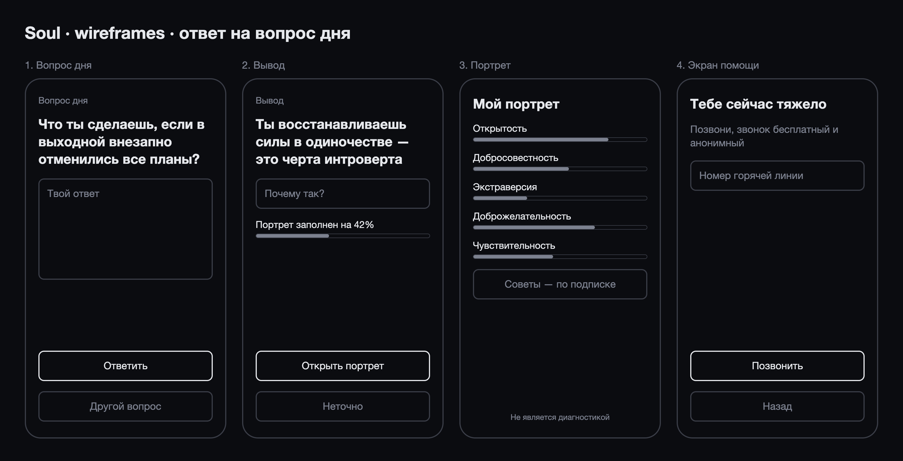

# Soul — проектирование (задание 4)

Soul — приложение, которое раз в день задаёт вопрос и по ответам собирает психологический портрет. Бизнес-модель, Lean Canvas и User Stories — в ветке `hw-1-2-3`.

## DDD: доменные зоны

| Зона | Что делает | Глоссарий (термин — в коде) |
|---|---|---|
| **Аккаунт** | Вход, профиль, настройки и удаление данных | Пользователь — `User`; Время вопроса — `QuestionTime`; Удаление аккаунта — `AccountDeletion` |
| **Вопросы** | Банк вопросов, выбор вопроса дня, push | Вопрос — `Question`; Вопрос дня — `DailyQuestion`; Пропуск — `Skip`; Банк вопросов — `QuestionBank` |
| **Портрет** | Хранит ответы, считает черты и пишет выводы | Ответ — `Answer`; Черта — `Trait` (одна из 5 черт Big Five); Вывод — `Insight`; Портрет — `Portrait`; Заполненность — `Completeness` |
| **Подписка** | Оплата, пробный период, доступ к платному контенту | Подписка — `Subscription`; Тариф — `Plan`; Платный контент — `PremiumContent` |
| **Безопасность** | Находит признаки кризиса и показывает контакты помощи | Кризисный сигнал — `CrisisSignal`; Экран помощи — `HelpScreen`; Горячая линия — `Hotline` |

Зоны не лезут в данные друг друга. «Вопросы» не знают, как считается портрет, они только передают `Answer` в «Портрет».

## BDD: критический путь MVP

Критический путь — ответ на вопрос дня: без ответов портрет не пополняется, а платят именно за портрет.

**Сценарий 1. Успех**

- **Дано:** пользователь прошёл стартовый опрос, и его портрет заполнен на 40%.
- **И:** в 20:00 ему пришёл push с вопросом дня «Что ты сделаешь, если в выходной внезапно отменились все планы?».
- **Когда:** пользователь открывает push и пишет ответ «Обрадуюсь, наконец посижу дома с книгой».
- **Тогда:** ответ сохраняется.
- **И:** за 5 секунд появляется вывод «Ты восстанавливаешь силы в одиночестве — это черта интроверта».
- **И:** заполненность портрета растёт до 42%.

**Сценарий 2. Отказ**

- **Дано:** пользователь открыл вопрос дня.
- **Когда:** пользователь пишет ответ, в котором есть признаки кризиса, например «не вижу смысла жить».
- **Тогда:** вывод не показывается.
- **И:** открывается экран помощи с номером горячей линии и кнопкой «Позвонить».
- **И:** ответ не попадает в расчёт портрета.

## Wireframes



Сценарий 1 проходит через экраны 1 → 2 → 3, сценарий 2 — через 1 → 4.

## API-First: контракты

**1. Отправить ответ на вопрос дня**

`POST /api/v1/answers`

Запрос:

```json
{
  "questionId": "q_1042",
  "type": "text",
  "text": "Обрадуюсь, наконец посижу дома с книгой"
}
```

Ответ `201 Created`, сценарий 1:

```json
{
  "answerId": "a_88213",
  "status": "accepted",
  "insight": {
    "text": "Ты восстанавливаешь силы в одиночестве — это черта интроверта",
    "trait": "extraversion"
  },
  "completeness": 42
}
```

Ответ `201 Created`, сценарий 2:

```json
{
  "answerId": "a_88214",
  "status": "crisis",
  "insight": null,
  "help": {
    "title": "Тебе сейчас тяжело. Позвони, звонок бесплатный и анонимный",
    "hotline": "TODO: номер горячей линии"
  }
}
```

Ошибка `422`, если ответ короче 10 символов:

```json
{
  "error": "answer_too_short",
  "message": "Ответ слишком короткий: нужно хотя бы 10 символов"
}
```

**2. Получить портрет**

`GET /api/v1/portrait`

Ответ `200 OK`:

```json
{
  "completeness": 42,
  "updatedAt": "2026-11-09T20:03:00+03:00",
  "traits": [
    { "code": "openness", "name": "Открытость опыту", "score": 78, "summary": "Любишь новое и легко загораешься идеями" },
    { "code": "conscientiousness", "name": "Добросовестность", "score": 55, "summary": "Планируешь важное, но в мелочах можешь импровизировать" },
    { "code": "extraversion", "name": "Экстраверсия", "score": 31, "summary": "Силы восстанавливаешь в одиночестве" },
    { "code": "agreeableness", "name": "Доброжелательность", "score": 70, "summary": "Стараешься избегать конфликтов" },
    { "code": "neuroticism", "name": "Эмоциональная чувствительность", "score": 46, "summary": "Переживаешь, но быстро приходишь в себя" }
  ],
  "premium": {
    "locked": true,
    "plan": "monthly_399"
  }
}
```
